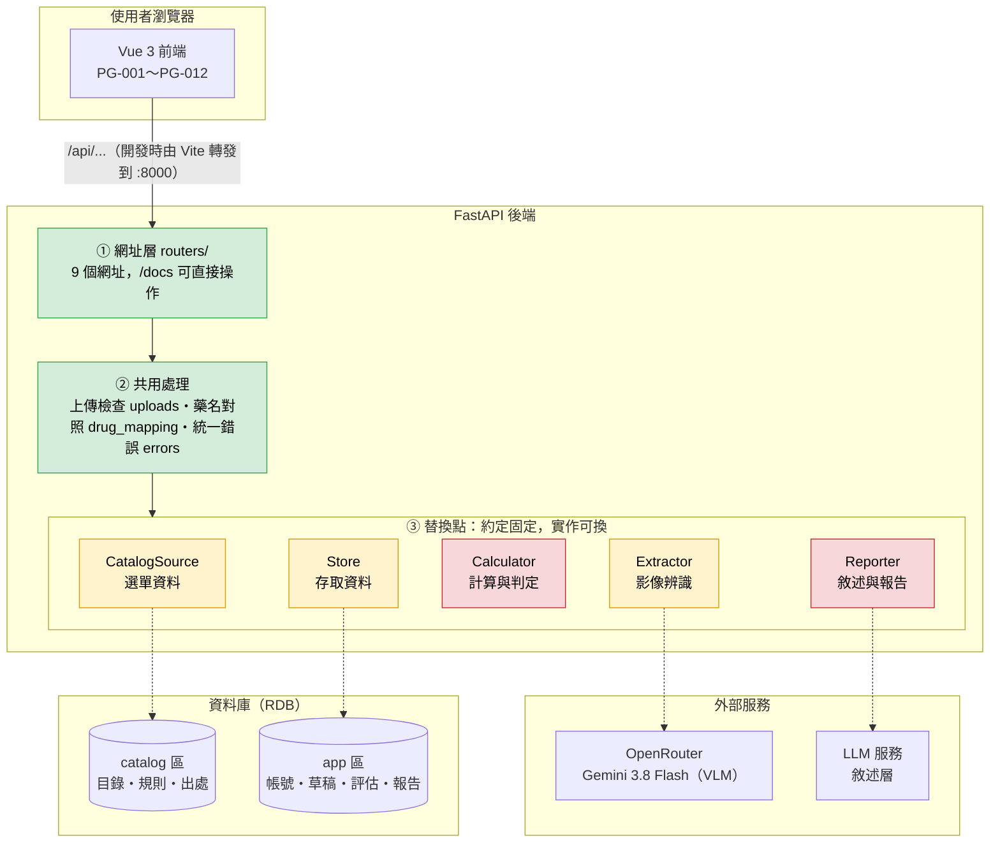
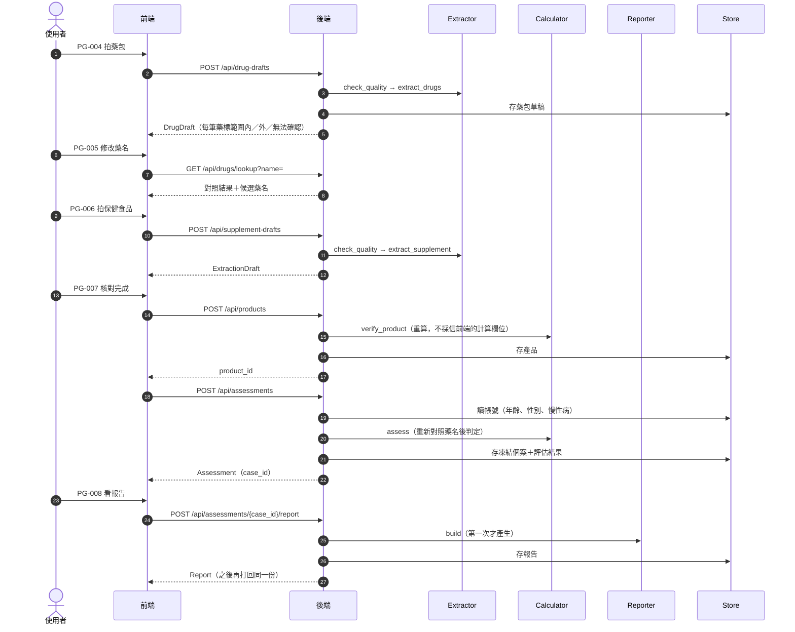

# 系統架構

這份文件說明系統由哪些程式與服務組成、彼此怎麼連線、資料存在哪裡。

- 資料處理的**步驟順序**（照片 → 辨識 → 核對 → 判定 → 敘述 → 報告）見 `docs/prd.md` 第七節。
- 每一步交接的**資料格式**見 `docs/schemas/README.md` 的 ①～⑧。
- 每個網址的**輸入輸出**見 `README.md` 的 API 對照表，或啟動後開 `/docs`。

---

## 一、整體架構

圖例：綠色＝已完成；黃色＝能用但還不是最終版本；紅色＝目前回固定範例。
虛線＝之後要接上的連線，目前還沒接。

### 四層的分工

| 層 | 位置 | 負責 | 不負責 |
|---|---|---|---|
| ① 網址層 | `app/routers/` | 收請求、檢查輸入、呼叫下層、組回應 | 任何計算或判定 |
| ② 共用處理 | `app/uploads.py`、`app/drug_mapping.py`、`app/errors.py` | 多個網址共用的邏輯 | 存資料、呼叫外部服務 |
| ③ 替換點 | `app/catalog_source.py`、`app/extractor.py`、`app/calculator.py`、`app/reporting.py`、`app/store.py` | 定好「給什麼、拿到什麼」，實際做法可換 | — |
| 資料格式 | `app/schemas/` | 每層之間傳的資料長什麼樣，進出都先驗證 | — |

上層只認下層的約定（Protocol），不管下層實際怎麼做。所以下層從假換成真時，上層不用改。

---

## 二、替換點

每個替換點都由三個部分組成：約定（Protocol）、實作、開關（`get_xxx()`）。
換實作時只改開關回傳的東西，網址與前端都不用改。

| 替換點 | 約定的方法 | 現在的實作 | 之後換成 | 接到 |
|---|---|---|---|---|
| CatalogSource | `load()` | 讀 `docs/schemas/examples/catalog/*.csv` | 讀資料庫 | catalog 區 |
| Extractor | `check_quality()`、`extract_supplement()`、`extract_drugs()` | 品質一律通過；草稿回範例 | 保健食品接 `app/extraction/engines/openrouter.py`（已寫好）；藥包辨識待寫 | OpenRouter |
| Calculator | `verify_product()`、`assess()` | 份數換算是真的；判定一律回 `06_assessment` 範例 | 單位換算、元素量推估、規則引擎 | catalog 區（規則表） |
| Reporter | `build()` | 一律回 `08_report` 範例 | LLM 敘述 → 輸出檢查（不合格重試 2 次，再失敗用固定模板） | LLM 服務 |
| Store | 產品、草稿、評估、報告的存取，全部帶 `user_id` | 記憶體（重啟就清空） | 讀寫資料庫 | app 區 |

測試時可以用 `app.dependency_overrides` 換成特製的假版本，例如 `tests/test_api_assessments.py`。

---

## 三、一次完整評估：前端打了哪些網址

PG-011／PG-012 查歷史報告時，只讀 Store：`GET /api/reports`、`GET /api/reports/{report_id}`。

---

## 四、處理步驟落在哪裡

對照 `docs/prd.md` 第七節的處理流程：

| 處理步驟 | 位置 | 有沒有用模型 |
|---|---|---|
| 上傳檔案檢查 | `uploads.py` | 否 |
| 影像品質檢查 | Extractor `check_quality` | 否 |
| 影像辨識 | Extractor `extract_*` → OpenRouter | **是（VLM）** |
| 名稱對照 | 藥名：`drug_mapping.py`；成分名：**尚未實作**（草稿的成分代碼目前來自範例） | 否 |
| 人工核對 | 前端 PG-005、PG-007 | — |
| 凍結評估個案 | `routers/assessments.py` | 否 |
| 計算層 → 規則引擎 | Calculator | 否 |
| 敘述層 | Reporter → LLM 服務 | **是（LLM）** |
| 輸出檢查 | Reporter | 否 |
| 報告 | Reporter 產生、Store 保存 | 否 |

模型只出現在兩處：讀照片（VLM）與把結論寫成白話（LLM）。
等級、數值、警示都在 Calculator 裡用程式決定，評估時不呼叫任何外部來源（ADR-0006）。

---

## 五、幾個設計決定

| 決定 | 原因 |
|---|---|
| 全部同步回傳，不建工作狀態表 | 前端顯示「辨識中…」等待即可（`docs/prd.md` 第七節）；少一張表與輪詢邏輯 |
| 錯誤一律回 `ErrorResponse` | 前端只寫一種錯誤處理 |
| 前端送藥名文字，後端重新對照 | 判定只依後端的對照結果，不信前端送來的代碼 |
| 前端送來的計算欄位一律不採信 | 攝取量、營養素量都由後端重算 |
| 同一個評估只產生一份報告 | 重新整理頁面不會得到不同的報告；資料庫的報告表 `case_id` 需設為不可重複 |
| 每筆資料都帶 `user_id` | 現在用測試帳號，接上登入後不用改結構；不是自己的資料一律回 404 |
