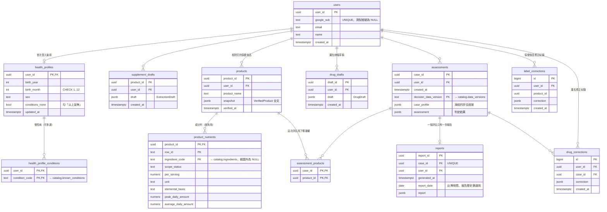
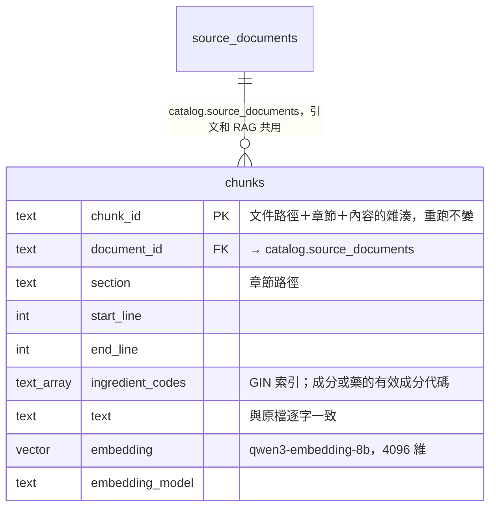

# 資料庫

一個 PostgreSQL 17（`pgvector/pgvector:pg17`），三個 schema。表的結構由 `migrations/` 的 Alembic migration 建立（純 SQL，不用 ORM）。

| schema | 放什麼 | 誰寫入 | 執行期 |
|---|---|---|---|
| `catalog` | 醫療參考資料：疾病、用藥、成分、DRIs、化合物、規則、出處 | 匯入腳本（從 git 的 `data/catalog/*.csv`） | 唯讀 |
| `app` | 使用者資料：帳號、健康資料、產品、草稿、評估、報告、修正紀錄 | 後端 API | 讀寫 |
| `evidence` | RAG 語料切塊與向量 | ingest 腳本（從 `data/sources/`） | 唯讀 |

後端**不直接讀 catalog 的表**，而是讀 `catalog.v_*` view：view 的欄位名稱與型別對齊 `app/schemas` 的模型，
表可以照資料庫的道理正規化，後端格式保持穩定。

```
data/catalog/*.csv（git，正本）──匯入腳本──► catalog.* 表 ──► catalog.v_* view ──► PgCatalogSource
data/sources/**/*.md（git）────ingest──────► evidence.chunks ───────────────────► 檢索（C-2）
後端 API ──────────────────────────────────► app.* 表 ◄──────────────────────────► PgStore（A-3）
```

## 怎麼起資料庫

```bash
cp .env.example .env          # 填 POSTGRES_PASSWORD；DATABASE_URL 的密碼要一樣
docker compose up -d db       # 127.0.0.1:5433，資料存在 docker volume
uv run alembic upgrade head   # 建三個 schema、表、view
uv run python -m app.db.import_catalog   # 匯入 data/catalog/*.csv
```

之後設 `CATALOG_SOURCE=pg`，`GET /api/catalog` 就改從 view 讀；預設 `csv` 不需要資料庫。
`CATALOG_SOURCE=pg` 時，伺服器第一次用到參考資料時讀一次並快取，**參考資料改版要重新匯入、重啟伺服器**。

| 指令 | 作用 |
|---|---|
| `uv run alembic upgrade head` | 建／升級表結構 |
| `uv run alembic downgrade base` | 全部砍掉（會刪掉所有資料） |
| `uv run python -m app.db.import_catalog` | 匯入參考資料；可重跑，結果相同 |
| `docker compose down -v` | 連資料庫的 volume 一起刪 |

## 匯入腳本做什麼

1. 用 `CsvCatalogSource` 讀 `data/catalog/`，每列先過 Pydantic 模型驗證（格式錯就不會碰資料庫）。
2. 在**一個交易**裡：記一筆 `data_versions` → 清空舊的 catalog 資料 → 寫入新資料。中途失敗整批回滾。
3. `source_documents` 由 `citations.csv` 的 `document_path` 與原文檔（`data/sources/`）產生：標題取檔案第一個 `# ` 標題，
   同一份文件的所有引文，網址、來源、抓取日期、版本必須一致。
4. `known_conditions`、`ingredients`、`data_versions` 會被 app 的表參照，所以用「更新或新增＋刪掉不在新資料裡的列」，
   不直接清空；其餘的表先清空再寫入。若 app 已經有人用到被刪掉的疾病或成分，匯入會因外鍵失敗並回滾。

## catalog 的表（20 張）

```mermaid
erDiagram
    known_conditions ||--o{ drug_classes : "疾病底下的用藥類別（腸胃用藥為 NULL）"
    drug_classes ||--o{ drug_item_classes : ""
    drug_items ||--o{ drug_item_classes : "複方一對多類別"
    drug_items ||--o{ drug_item_conditions : "相關疾病（只排序）"
    known_conditions ||--o{ drug_item_conditions : ""
    drug_items ||--o{ drug_tradenames : "常見商品名"
    drug_items ||--o{ drug_product_ingredients : ""
    drug_products ||--o{ drug_product_ingredients : "TFDA 藥名 → 有效成分（複方多列）"
    drug_items ||--o{ drug_nutrient_doses : "制酸劑劑量選項"
    ingredients ||--o{ drug_nutrient_doses : "貢獻哪個營養素"
    ingredients ||--o{ ingredient_synonyms : "名稱標準化"
    ingredients ||--o{ dris_values : "性別 × 年齡層"
    ingredients ||--o{ compounds : "化合物 → 元素比率"
    ingredients ||--o{ conversion_factors : "單位換算"
    ingredients ||--o{ rules : "規則針對的成分"
    drug_classes ||--o{ rules : "condition_type = drug_class"
    drug_items ||--o{ rules : "condition_type = drug_ingredient"
    rules ||--o{ rule_citations : ""
    citations ||--o{ rule_citations : "一段原文可支持多條規則"
    source_documents ||--o{ citations : "引文出自哪份文件"
    data_versions ||--o{ rules : "匯入批次"

    known_conditions {
        text condition_code PK
        text display_name_zh
        text backend_name
        int sort_order
    }
    drug_classes {
        text drug_class_code PK
        text condition_code FK "NULL = 腸胃用藥"
        text display_name_zh
        text plain_description_zh
        text role "CHECK rule_bearing / coverage_only"
        text menu_group
    }
    drug_items {
        text active_ingredient_code PK
        text display_name_zh
        text english_name
        bool requires_dose
    }
    drug_item_classes {
        text active_ingredient_code PK,FK
        text drug_class_code PK,FK
    }
    drug_item_conditions {
        text active_ingredient_code PK,FK
        text condition_code PK,FK
    }
    drug_tradenames {
        int id PK
        text active_ingredient_code FK
        text tradename
    }
    drug_products {
        int product_id PK
        text name "TFDA 品名，UNIQUE(name, lang)"
        text lang "zh / en"
        text_array out_of_scope_ingredients "範圍外的處方成分原文"
    }
    drug_product_ingredients {
        int product_id PK,FK
        text active_ingredient_code PK,FK
    }
    drug_nutrient_doses {
        text active_ingredient_code PK,FK
        numeric dose_option_mg PK
        text nutrient_code PK,FK
        numeric elemental_mg_per_unit
        text source
    }
    ingredients {
        text code PK
        text category "CHECK target_nutrient / allowed_ingredient"
        text display_name_zh
        text standard_unit "目標營養素必填（CHECK）"
        text_array accepted_units
        text ul_scope "NULL = 無 UL"
    }
    ingredient_synonyms {
        int id PK
        text ingredient_code FK
        text synonym "UNIQUE"
    }
    out_of_scope_names {
        text name PK
        text note
    }
    dris_values {
        text nutrient_code PK,FK
        text sex PK
        text age_band PK
        text reference_type "rda / ai"
        numeric reference_value
        numeric ul_value "NULL = 無上限"
        text unit
    }
    compounds {
        text compound_code PK
        text nutrient_code FK
        text display_name_zh
        text_array synonyms
        text formula
        numeric ratio "CHECK 0 < ratio <= 1"
        text source
    }
    conversion_factors {
        int id PK
        text nutrient_code FK
        text from_unit
        text to_unit
        numeric factor
        text applies_to_form "all 或型態代碼"
        text source
    }
    rules {
        text rule_id PK
        text condition_type
        text drug_class_code FK "CHECK 與 condition_type 一致"
        text active_ingredient_code FK "二選一"
        text ingredient_code FK
        text_array ingredient_form_codes
        text interaction_type
        bool requires_supplement_intake
        bool requires_professional_review
        text advice_code
        numeric separation_hours "CHECK 只有 separate_timing 可填"
        text reason_zh
        text evidence_tier
        text status "draft / reviewed / retired"
        text curated_by
        text reviewed_by
        date reviewed_at
        text curation_note
        text data_version FK
    }
    rule_citations {
        text rule_id PK,FK
        text citation_id PK,FK
    }
    citations {
        text citation_id PK
        text document_id FK
        text section
        text quote "逐字原文"
        text population
        text source_record_id
    }
    source_documents {
        text document_id PK
        text source "nih_ods / nccih / dris_tw / tfda_label"
        text title
        text url
        text jurisdiction
        date retrieved_at
        text source_version
        text file_path "data/sources/ 底下的相對路徑"
    }
    data_versions {
        text version PK "例如 2026.11.1"
        timestamptz imported_at
        text note
    }
```



實作上的小差異：每張要保持順序的表多一個 `ord` 欄位（匯入時的 CSV 列順序，view 靠它還原順序，後端拿到的清單才會跟
CSV 版一樣）；`drug_products` 沒有 `snapshot_date`（TFDA 藥名表的快照日期是 2026-10-19，CSV 沒有這個欄位）。

### 約束（資料庫自己擋錯）

| 表 | 約束 | 擋什麼 |
|---|---|---|
| `rules` | `CHECK ((condition_type='drug_class') = (drug_class_code IS NOT NULL))` 且兩個 FK 恰好一個非空 | 規則條件寫成類別卻沒填類別 |
| `rules` | `CHECK ((interaction_type='drug_affects_nutrient') = (NOT requires_supplement_intake))` | 「沒補也提醒」的規則被設成要補才提醒 |
| `rules` | `CHECK ((advice_code='separate_timing') = (separation_hours IS NOT NULL))` | 錯開時數和建議不一致 |
| `rules` | `CHECK (status <> 'reviewed' OR (reviewed_by IS NOT NULL AND reviewed_at IS NOT NULL AND reviewed_by <> curated_by))` | 自己審自己 |
| `rules` | `CHECK (reason_zh !~ '(^|[^A-Za-z0-9-])[0-9]')` | 說明文字夾帶數字（B12 這種名稱不算） |
| `ingredients` | `CHECK (category='allowed_ingredient' OR standard_unit IS NOT NULL)` | 目標營養素沒有標準單位 |
| `compounds` | `CHECK (ratio > 0 AND ratio <= 1)` | 元素比率超過 100% |
| `dris_values` | `CHECK (ul_value IS NULL OR ul_value > 0)`、PK 三欄 | 上限為零、同一族群重複兩個值 |

每條都有「違反就寫不進去」的測試：`tests/db/test_constraints.py`。

### view（後端只讀這些）

| view | 對齊的模型 | 怎麼組 |
|---|---|---|
| `v_known_conditions` | `KnownCondition` | 直接選欄位 |
| `v_drug_classes` | `DrugClass` | 直接選欄位 |
| `v_drug_items` | `DrugItem` | 子查詢組出類別、商品名、相關疾病的陣列 |
| `v_drug_products` | `DrugProduct` | 品名＋子查詢組出有效成分陣列 |
| `v_drug_nutrient_doses` | `DrugNutrientDose` | 直接選欄位 |
| `v_ingredients` | `Ingredient` | 子查詢組出同義詞陣列 |
| `v_out_of_scope_names` | `OutOfScopeName` | 直接選欄位 |
| `v_dris_values` | `DrisValue` | 直接選欄位 |
| `v_compounds` | `CompoundRatio` | 直接選欄位 |
| `v_conversion_factors` | `ConversionFactor` | 直接選欄位 |
| `v_rules` | `Rule` | `condition_code = COALESCE(drug_class_code, active_ingredient_code)`，子查詢組出 citation_ids |
| `v_citations` | `Citation` | `citations JOIN source_documents` |

## app 的表（12 張）

使用者資料。目前只建好表，`PgStore`（A-3）才開始讀寫。



評估個案、判定結果、報告是**凍結的快照**，存成 jsonb 才能原樣重現當時的報告；但要查詢的東西
（`user_id`、`case_id`、`report_date`、`decision_data_version`、成分列）拆成一般欄位並建索引。

## evidence 的表（1 張）

RAG 語料，C-2 才寫入。報告的亮點：規則引用的原文（`catalog.citations`）和 RAG 撈出的段落（`evidence.chunks`）
指向同一張 `catalog.source_documents`，判定的依據和解釋的依據是同一批文件，都能回溯到原檔第幾行。
`embedding` 不固定維度、不建向量索引（ADR-0003：4096 維超過 pgvector 近似索引上限，先用成分標籤篩選再算距離）。



## 測試

```bash
uv run pytest                 # 沒設 DATABASE_URL 時，tests/db 全部略過（skipped），不需要資料庫
DATABASE_URL=postgresql://... uv run pytest tests/db    # 有資料庫時
```

資料庫測試另建名稱加 `_test` 的資料庫（每次測試程序開始時砍掉重建），不會動到開發用的資料。重點測試：

- CSV 版與資料庫版回傳的 `ReferenceData` 完全相等（`tests/db/test_catalog_source.py`）
- 重跑匯入結果相同；中途失敗整批回滾
- 每個 CHECK 約束都有違反就寫不進去的測試
- CI（`.github/workflows/ci.yml`）有 `pgvector/pgvector:pg17` service，會跑這些測試
